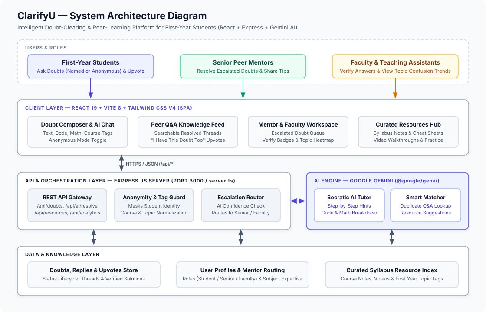
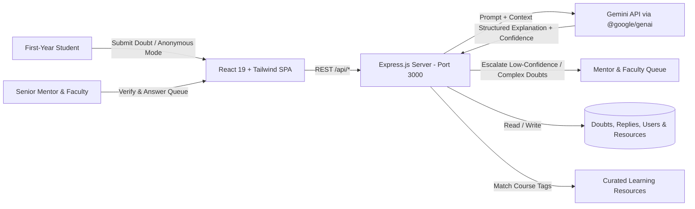

# ClarifyU — Intelligent Doubt-Clearing Assistant for First-Year Students

An AI-powered doubt-resolution and peer-learning React application designed to help first-year students overcome classroom hesitation, get instant 24/7 explanations, escalate complex questions to senior mentors or faculty, and discover curated learning resources.

> **Problem Statement #27:** *First-year students often hesitate to ask doubts in class and receive delayed responses outside classroom hours. Develop an AI-based doubt-resolution or peer-learning platform that connects students with faculty, seniors, or curated learning resources.*

---

## Key Documentation

- **Product Requirements Document:** [`prd.md`](./prd.md)
- **System Architecture Diagram:** [`architecture-diagram.svg`](./architecture-diagram.svg)

---

## Core Features

1. **Judgment-Free & Anonymous Doubt Asking:** First-year students can post text, code snippets, or math questions with an optional **Anonymous Mode** toggle.
2. **24/7 AI Doubt Resolver:** Instant, structured explanations (concept recap, step-by-step hints, pitfalls) powered by Gemini via a secure server-side API route.
3. **Smart Mentor & Faculty Escalation:** One-click escalation routes unresolved doubts to subject-matched **Senior Peer Mentors** or **Faculty / TAs** with verified-solution badges.
4. **Peer-Learning Q&A Feed:** Searchable knowledge base with **"I have this doubt too"** upvoting so common class hurdles surface immediately.
5. **Curated Learning Resources Hub:** Course-tagged lecture notes, cheat sheets, video walkthroughs, and practice sets linked automatically to student doubts.
6. **Faculty Topic Insights:** Aggregated view of high-frequency doubts so instructors know which topics need re-explaining in class.

---

## Architecture Overview





---

## Tech Stack

- **Frontend:** React 19, TypeScript, Vite 8, Tailwind CSS v4, Lucide React, Motion
- **Backend:** Express.js (`server.ts` via `tsx`) serving `/api/*` and Vite middleware
- **AI Engine:** Google Gemini SDK (`@google/genai`)

---

## Planned Project Structure

```text
.
├── architecture-diagram.svg   # Visual system architecture diagram
├── prd.md                     # Product Requirements Document
├── readme.md                  # Project overview and setup guide
├── index.html                 # HTML entry point & metadata
├── metadata.json              # App metadata & capabilities
├── package.json               # Dependencies & scripts
├── server.ts                  # (Planned) Express API & Gemini proxy server
├── .env.example               # Environment variable template
└── src/
    ├── main.tsx               # React root mount
    ├── index.css              # Tailwind CSS v4 entry
    ├── App.tsx                # Main application shell & routing
    ├── components/            # (Planned) DoubtForm, AIChatPanel, PeerFeed, ResourceHub, MentorQueue
    └── types/                 # (Planned) Shared TypeScript interfaces
```

---

## Getting Started

1. **Install dependencies:**
   ```bash
   npm install
   ```

2. **Configure environment variables:**
   Copy `.env.example` to `.env` and set your Gemini API key:
   ```bash
   cp .env.example .env
   ```
   ```env
   GEMINI_API_KEY="your_gemini_api_key"
   ```

3. **Run the development server (port 3000):**
   ```bash
   npm run dev
   ```

4. **Type-check and build for production:**
   ```bash
   npm run lint
   npm run build
   ```
