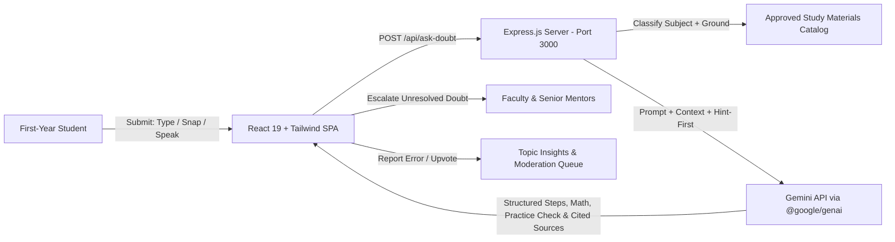

# DoubtBridge — Intelligent Doubt-Clearing Assistant for First-Year Students

An AI-powered doubt-resolution and peer-learning React application built for first-year B.Tech CSE (AI & ML) students at **Assam Skill University** (Group No. 5: Shristii Baruah `IT26B0120`, Aichajya Neog `IT26B0121`, S Sushmi Singha `IT26B0122`). **DoubtBridge** helps students overcome classroom hesitation, get instant 24/7 syllabus-grounded explanations, practice actively with Hint-first mode, escalate unresolved questions to faculty or senior mentors, and surface high-confusion topics for instructors.

> **Problem Statement #27:** *First-year students often hesitate to ask doubts in class and receive delayed responses outside classroom hours. Develop an AI-based doubt-resolution or peer-learning platform that connects students with faculty, seniors, or curated learning resources.*

---

## Key Documentation

- **Product Requirements Document:** [`prd.md`](./prd.md)
- **Design Specification:** [`design.md`](./design.md)
- **System Architecture Diagram:** [`architecture-diagram.svg`](./architecture-diagram.svg)

---

## Core Features

1. **Multi-Modal Doubt Submission (Type / Snap / Speak):** Ask questions via text, attach handwritten problem photos or PDFs, or use **Voice Dictation** (`useVoiceInput`) directly from the Overview quick bar or Ask Doubt workspace.
2. **Classify & Ground Against Approved Study Materials:** Every question is classified by first-year subject (`Calculus`, `Physics`, `C Programming`) and grounded against faculty-approved lecture notes and lab manuals with clickable **Cited Approved Sources** linking into the Resources library.
3. **Hint-First Mode & Practice Check:** Optional Socratic **Hint-first mode** helps prevent over-reliance by giving conceptual nudges before full solutions, paired with an interactive **Practice check** card and toggleable hint on every AI explanation.
4. **Subject-Matched Mentor & Faculty Escalation:** One-click escalation routes unresolved doubts directly to faculty and senior mentors — **Abhishek Sharma** (Maths / Calculus), **Dr. Paragjyoti** (Physics), **Munsifa Khan** (C Programming), and **Rohan Sen** (Senior Mentor).
5. **Peer-Learning Feed & Topic Insights:** Searchable academic Q&A feed with upvotes and replies, plus a **Topic Insights** view showing doubt volume per subject and flagged AI answers awaiting faculty review.
6. **Report Error Moderation Loop:** Students can flag inaccurate, off-syllabus, or unverified AI answers with a reason (`Inaccurate step or calculation`, `Off-syllabus explanation`, `Needs faculty verification`) for faculty review.

---

## Architecture Overview




---

## Tech Stack

- **Frontend:** React 19, TypeScript, Vite 8, Tailwind CSS v4, KaTeX, Lucide React, Motion
- **Backend:** Express.js (`server.ts` via `tsx`) serving `/api/*` and Vite middleware
- **AI Engine:** Google Gemini SDK (`@google/genai`)

---

## Project Structure

```text
.
├── architecture-diagram.svg   # DoubtBridge system architecture diagram
├── design.md                  # Misty Rose / Coral Peach iOS-style UI spec
├── prd.md                     # Product Requirements Document
├── readme.md                  # Project overview and setup guide
├── index.html                 # HTML entry point & metadata
├── metadata.json              # App metadata & capabilities
├── package.json               # Dependencies & scripts
├── server.ts                  # Express API & Gemini proxy server
├── .env.example               # Environment variable template
└── src/
    ├── main.tsx               # React root mount
    ├── index.css              # Tailwind CSS v4 + KaTeX styles
    ├── App.tsx                # Main application shell & routing
    ├── hooks/                 # Web Speech API voice input hook
    ├── data/                  # Assam Skill University academic & course data
    ├── components/            # Overview, AskDoubt, Community, Resources, Mentors, Profile
    └── types/                 # Shared TypeScript interfaces
```

---

## Getting Started

1. **Install dependencies:**
   ```bash
   npm install
   ```

2. **Configure environment variables:**
   Copy `.env.example` to `.env` and set your Gemini API key:
   ```bash
   cp .env.example .env
   ```
   ```env
   GEMINI_API_KEY="your_gemini_api_key"
   ```

3. **Run the development server (port 3000):**
   ```bash
   npm run dev
   ```

4. **Type-check and build for production:**
   ```bash
   npm run lint
   npm run build
   ```
